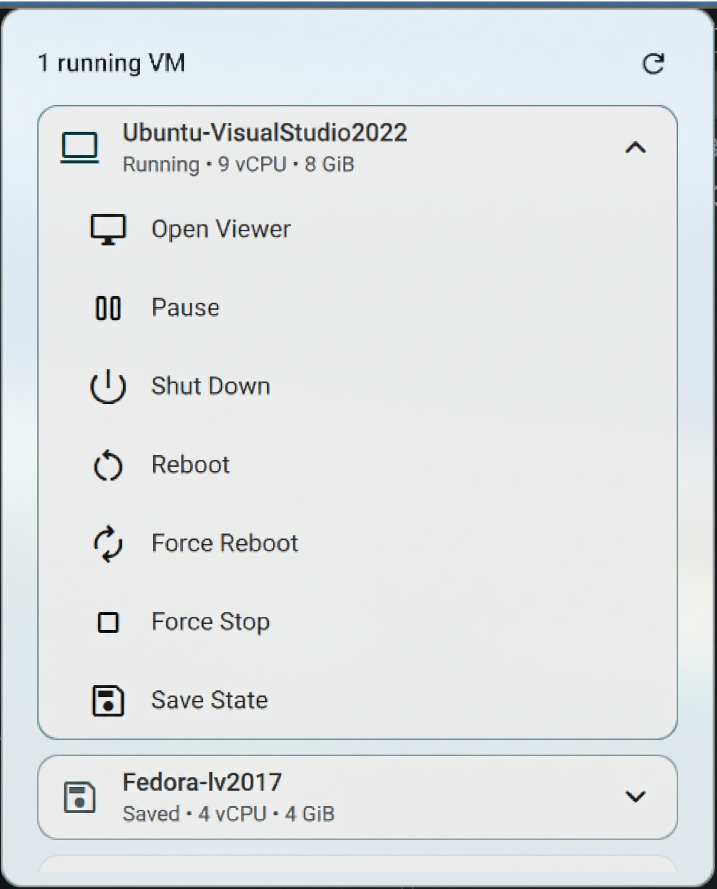
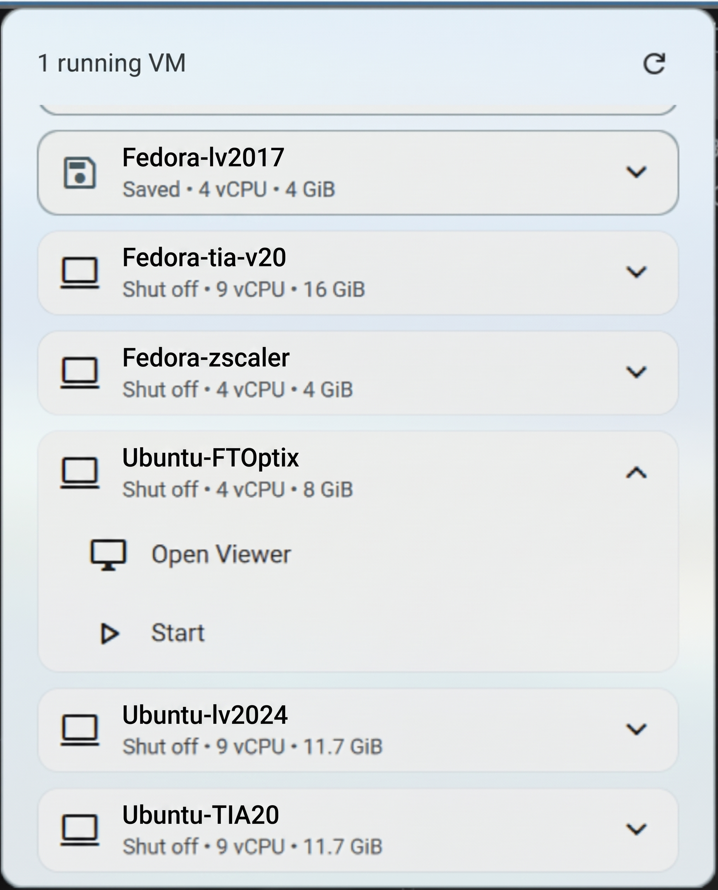

# DMS Virtual Machine Manager

libvirt/KVM virtual machine monitoring and management plugin for [DankMaterialShell](https://danklinux.com/).

UI modelled after [DmsDockerManager](https://github.com/LuckShiba/DmsDockerManager).

## Screenshots

| Running VM | Shut off VM |
|:---:|:---:|
|  |  |

Only the actions available in the current state of the VM are shown.

## Features

- Bar widget with a VM icon and the number of active (running/paused) VMs
- Popout listing every VM defined on the libvirt connection, with state, vCPU and memory
- Per-VM actions: Open Viewer (`virt-viewer`), Start / Restore, Pause / Resume, Shut Down, Reboot, Force Reboot,
  Force Stop, Save State, Discard Saved State
- Only the actions available in the current VM state are shown
- Destructive actions (Force Reboot, Force Stop, Discard Saved State) require a second click
- Live updates through `virsh event`, optional fallback polling
- Keyboard navigation

## Installation

### Manual

```sh
git clone https://github.com/solax76/DmsVirtualManager ~/.config/DankMaterialShell/plugins/virtManager
# or, for development:
ln -s "$PWD" ~/.config/DankMaterialShell/plugins/virtManager
```

1. Open Settings -> Plugins and click "Scan"
2. Enable "Virtual Machine Manager"
3. Add "Virtual Machine Manager" to your DankBar widgets list

## Requirements

- `libvirt` with `virsh` (package `libvirt-clients` / `libvirt`)
- `virt-viewer` for the console
- Your user must be able to talk to the connection without a password prompt —
  for `qemu:///system` add it to the `libvirt` group: `sudo usermod -aG libvirt $USER`

## Configuration

- **Viewer Command** (default `virt-viewer --hotkeys=release-cursor=Super_L`; `--connect <uri> --wait <vm>` is appended)

The libvirt connection is fixed to `qemu:///system`.

## Actions

| Action | virsh command | Available when |
|---|---|---|
| Open Viewer | `<viewer command> --connect <uri> --wait <vm>` | always |
| Start / Restore | `start` | shut off (Restore if a saved state exists) |
| Pause / Resume | `suspend` / `resume` (`dompmwakeup` if PM-suspended) | running / paused |
| Shut Down | `shutdown` | running |
| Reboot | `reboot` | running |
| Force Reboot | `reset` | running or paused |
| Force Stop | `destroy` | active |
| Save State | `managedsave` | running or paused |
| Discard Saved State | `managedsave-remove` | shut off with saved state |

## Keyboard Navigation

- `Up/Down`, `Tab/Shift+Tab`, `Ctrl+J/K`, `Ctrl+N/P` — move between VMs / actions
- `Enter` / `Space` — expand/collapse VM, or run the selected action
- `Right` / `Ctrl+L` — enter the action list; `Left` / `Ctrl+H` — leave it / collapse
- `R` — refresh
